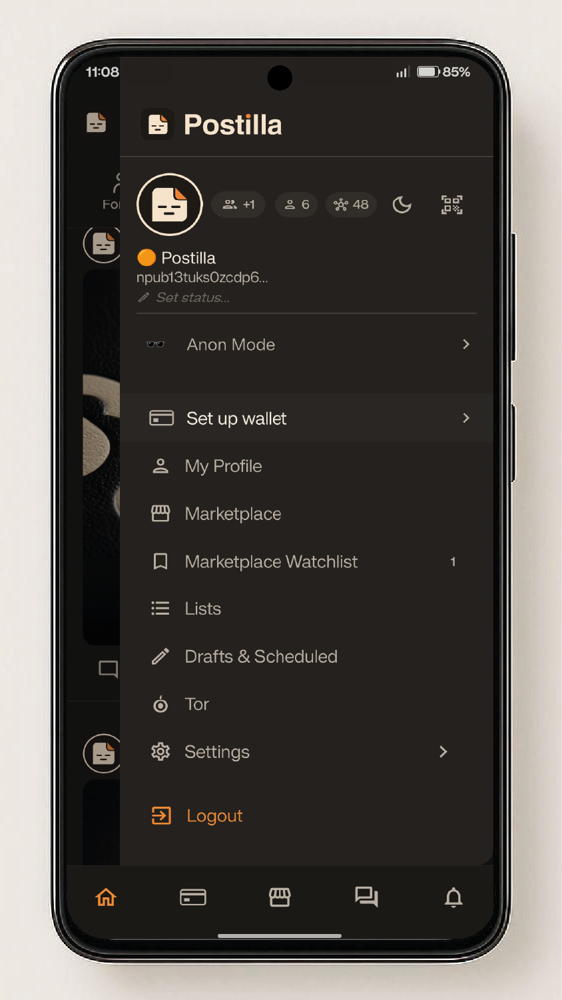

# Postilla

<strong>A place for things worth sharing.</strong>

  An independent, open-source Android client for Nostr — bringing social publishing, private conversations, Lightning and a community marketplace together in one app.

  <a href="https://github.com/isolabellart/postilla-android">Source code</a> ·
  <a href="https://github.com/isolabellart/postilla-android/releases">Download releases</a> ·
  <a href="https://github.com/barrydeen/dark-wisp-android">Original Dark Wisp project</a>

Postilla is an independently maintained downstream project built on the foundations of [Dark Wisp for Android](https://github.com/barrydeen/dark-wisp-android). It is not an official release of the upstream project.

---

## Postilla, in everyday use

Postilla is a mobile home for your Nostr identity. From one Android app you can:

- **Follow and discover:** read feeds and profiles, search for people and topics, follow hashtags and join conversations.
- **Share:** publish text, photos, picture-focused posts, videos and polls; add descriptions to media and save drafts.
- **Take part:** reply, repost, react, bookmark content and receive notifications about activity that matters to you.
- **Read articles:** open long-form Nostr articles and follow the discussions around them.
- **Message privately:** exchange encrypted direct messages, share media and translate conversations when needed.
- **Explore the Marketplace:** browse products and services, publish listings, save favourites, comment and contact sellers.
- **Use Lightning:** manage a wallet, send and receive payments, create a Lightning address and send Zaps.
- **Join communities:** discover and participate in NIP-29 groups and follow live activities.
- **Stay in control:** manage accounts, keys, relays, privacy filters and optional Tor routing.

Postilla is built around an open network: your identity is yours, and your experience is not tied to a single social platform or central server.

## Screenshots

  
  
  
  
  

## The Postilla identity

Postilla's visual language is editorial and understated: warm ivory, deep charcoal, generous whitespace and a restrained orange accent.

  

---

# Technical overview

## Social, publishing and discovery

- Home feeds, profile timelines, hashtag feeds, profile and content search.
- Text notes, replies, quotes and reposts; emoji and custom-emoji reactions.
- Picture-focused posts (NIP-68), video posts (NIP-71), media descriptions and gallery mode.
- Polls (NIP-88) and Zap polls (NIP-69).
- Long-form articles (NIP-23) with formatted content and threaded discussion reading.
- Notifications, bookmarks, pinned notes, mute lists and custom lists/follow sets (NIP-51).
- Draft creation and restoration using NIP-37.
- Profile editing, NIP-05 verification, mentions, QR codes and NIP-19 identifiers.

## Private messaging

- NIP-17 direct messages using gift wraps (rumor, seal and gift wrap), with NIP-44 encryption.
- Legacy NIP-04 cryptography for compatibility.
- Dedicated private-message relay preferences, including NIP-17 kind 10050.
- Encrypted media attachments and private message reactions.
- Remote signing through compatible Android signer apps such as Amber (NIP-55).
- On-demand message translation using the integrated translation services; the original Nostr message is not changed.
- Links from Marketplace conversations to the listing being discussed.

## Marketplace

The built-in Marketplace uses NIP-99 addressable listings (kind 30402).

- Browse all listings, listings from followed accounts or a user's own listings.
- Search and filter by category; open listing details and seller profiles.
- Publish, edit and withdraw your own product or service listings.
- Resolve listings by their stable author-and-identifier address, so revisions are not treated as separate products.
- Show price, images, location and availability information when supplied by the seller.
- Save listings to a personal NIP-51 watchlist and display community interest.
- React to listings, send Zaps and publish NIP-22 comments on addressable listings.

**Scope note:** this is a listing and discovery experience, not a full escrow or order-management platform. NIP-22 support is partial: top-level comments on addressable listings are supported, while replies to comments still use the regular NIP-10 note-thread model.

## Lightning and payments

- Embedded wallet powered by Breez SDK Spark.
- Nostr Wallet Connect (NWC / NIP-47) for compatible external wallets.
- Send and receive Lightning payments, scan or import invoices, and view transaction activity.
- Lightning address management where supported by the wallet service.
- Nostr Zaps (NIP-57) and Zap-enabled interactions.
- On-chain withdrawal support through the Spark wallet integration.
- Additional payment targets and currency display/conversion tools.

Keep recovery phrases, private keys and wallet connection strings secret. Postilla will never need you to share them with another person.

## Groups, live activity and media

- NIP-29 relay-based groups: discovery, joining, group chat and selected group-management actions.
- NIP-53 live activities and streams.
- Blossom upload and retrieval for media, with per-account server preferences and signed upload authorization.
- Optional encrypted media uploads for supported private-message attachments.
- Image, animated image, audio and video display/playback, including Android media controls and picture-in-picture where supported.

NIP-29 group administration is not yet a complete implementation of every protocol command.

## Relays, privacy and account control

- Multiple Nostr accounts and local key management.
- Optional remote signing through NIP-55-compatible signer apps.
- NIP-65 outbox/inbox relay lists, relay-aware event discovery and author-based read routing.
- Relay information (NIP-11), relay authentication (NIP-42), health tracking, reconnect handling and diagnostics.
- Optional embedded Tor routing for app network traffic.
- Mute lists, blocked users and relay filters, keyword filtering and social-graph controls.
- NIP-05 identity verification and NIP-19 npub, nsec, note, nevent, nprofile and naddr identifiers.
- Local event and conversation caching to improve continuity and responsiveness.

Nostr is a decentralized network: event availability, history and delivery depend on the relays chosen by users and by the people they follow. A client cannot retrieve an event that is no longer available from any relay and was never saved locally.

## Protocol support

Postilla includes implementations or integrations for the following protocols. The scope is not identical for every NIP; the notes above describe important limitations.

| Protocol | Use in Postilla |
|---|---|
| NIP-01, 02 | Core events and follow lists |
| NIP-04, 17, 44 | Legacy and modern encrypted messaging |
| NIP-05, 19 | Identity verification and human-readable identifiers |
| NIP-09, 10, 18, 25, 30 | Deletion, threads, reposts, reactions and custom emoji |
| NIP-11, 42, 65 | Relay information, authentication and relay lists |
| NIP-13 | Proof of Work |
| NIP-22 | Comments; partial support as described above |
| NIP-23 | Long-form article reading |
| NIP-29, 53 | Groups and live activities |
| NIP-37, 51 | Drafts, bookmarks, lists and mute data |
| NIP-47, 55, 57 | Nostr Wallet Connect, remote signing and Zaps |
| NIP-68, 71 | Picture-focused and video posts |
| NIP-69, 88 | Zap polls and polls |
| NIP-78 | Application-specific data |
| NIP-99 | Classified listings and Marketplace |

Additional integrations include Blossom media servers, Lightning invoices (BOLT-11), Breez SDK Spark, DeepL and Android remote-signer applications.

---

## Architecture and technology

Postilla is a native Android application written in Kotlin. Its interface is built with Jetpack Compose and Material 3; the app follows an MVVM-oriented architecture with repositories, coroutines and reactive state.

| Area | Main technologies |
|---|---|
| Language and build | Kotlin, Gradle, Android Gradle Plugin |
| Interface | Jetpack Compose, Material 3 |
| State and concurrency | Android ViewModel, Kotlin Coroutines and Flow |
| Relay connections | OkHttp WebSockets |
| Serialization | kotlinx.serialization |
| Cryptography | secp256k1, Bouncy Castle and Android protected storage |
| Local persistence | ObjectBox and encrypted preferences |
| Media | Coil, AndroidX Media3 and CameraX |
| Wallet | Breez SDK Spark and NWC |
| Translation | ML Kit and DeepL |
| Privacy routing | Embedded Tor runtime |

### Android compatibility

- Minimum Android version: **Android 8.0 (API 26)**.
- Target SDK: **35**.
- Packaged native ABI: **arm64-v8a**.
- Production application ID: **com.isolabellart.darkwispenhanced**.
- Staging application ID: **com.isolabellart.darkwispenhanced.staging**.

The production application ID and permanent signing identity are retained from the Dark Wisp Enhanced installation line. This allows a correctly signed Postilla build to update that app line; it does not migrate data from the separate upstream Dark Wisp application.

## Build from source

Requirements: JDK 17 and Android SDK 35.

~~~bash
git clone https://github.com/isolabellart/postilla-android.git
cd postilla-android

# Unit tests for the staging variant
./gradlew testStagingUnitTest

# Local debug APK
./gradlew assembleDebug

# Staging APK
./gradlew assembleStaging

# Release APK (requires the permanent signing configuration)
./gradlew assembleRelease
~~~

Release signing material is kept outside the repository. See [RELEASE_SIGNING.md](RELEASE_SIGNING.md), [the development guide](docs/DEVELOPMENT.md), [branching model](docs/BRANCHING.md), [CI/CD map](docs/CI_CD.md) and [release process](docs/RELEASE_PROCESS.md). GitHub Release and Zapstore publication use separate protected workflows.

## Contributing

Bug reports, testing and focused contributions are welcome. Use a feature branch, keep changes scoped, add or update tests where practical, and include the validation performed in your pull request. User-facing changes should also be checked on a real Android device.

## Project lineage and license

Postilla is an independent downstream fork of [Dark Wisp for Android](https://github.com/barrydeen/dark-wisp-android). It is not affiliated with or endorsed by the upstream project.

The project is distributed under the [MIT License](LICENSE). See the license file for the complete terms.

<strong>Built with care for the Nostr ecosystem.</strong>

