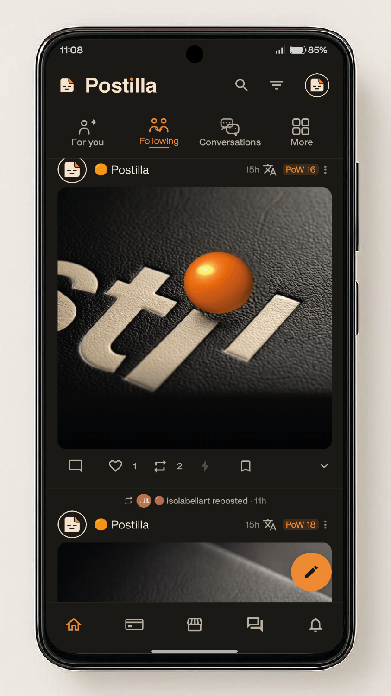
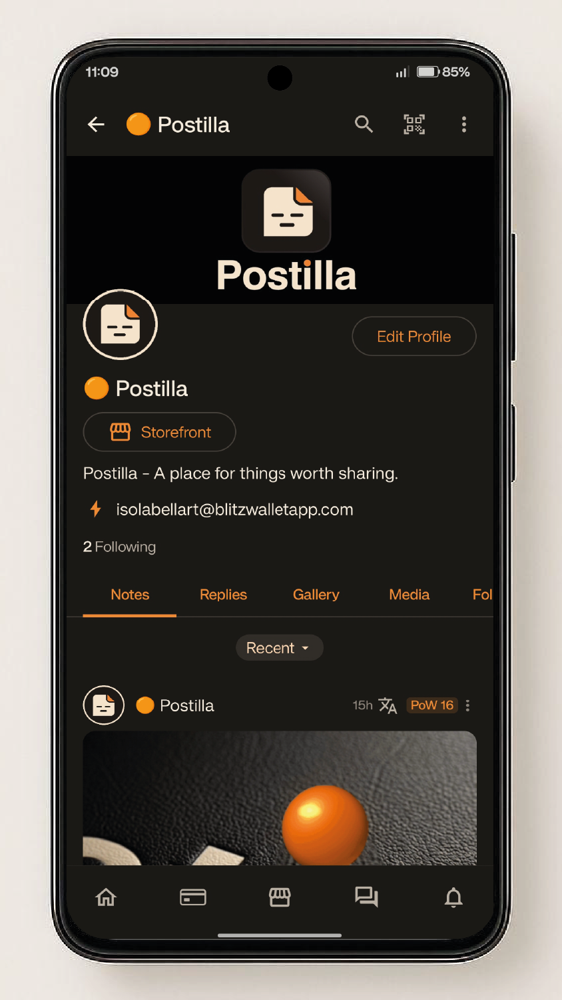
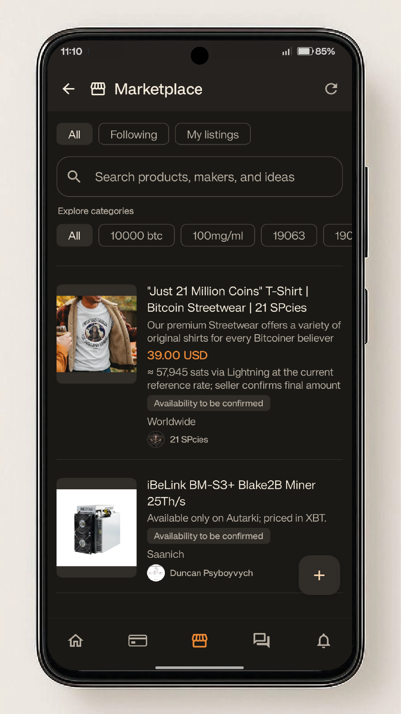
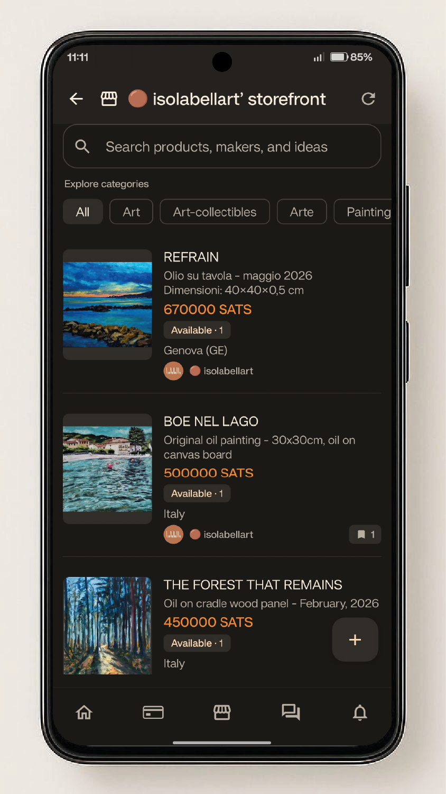
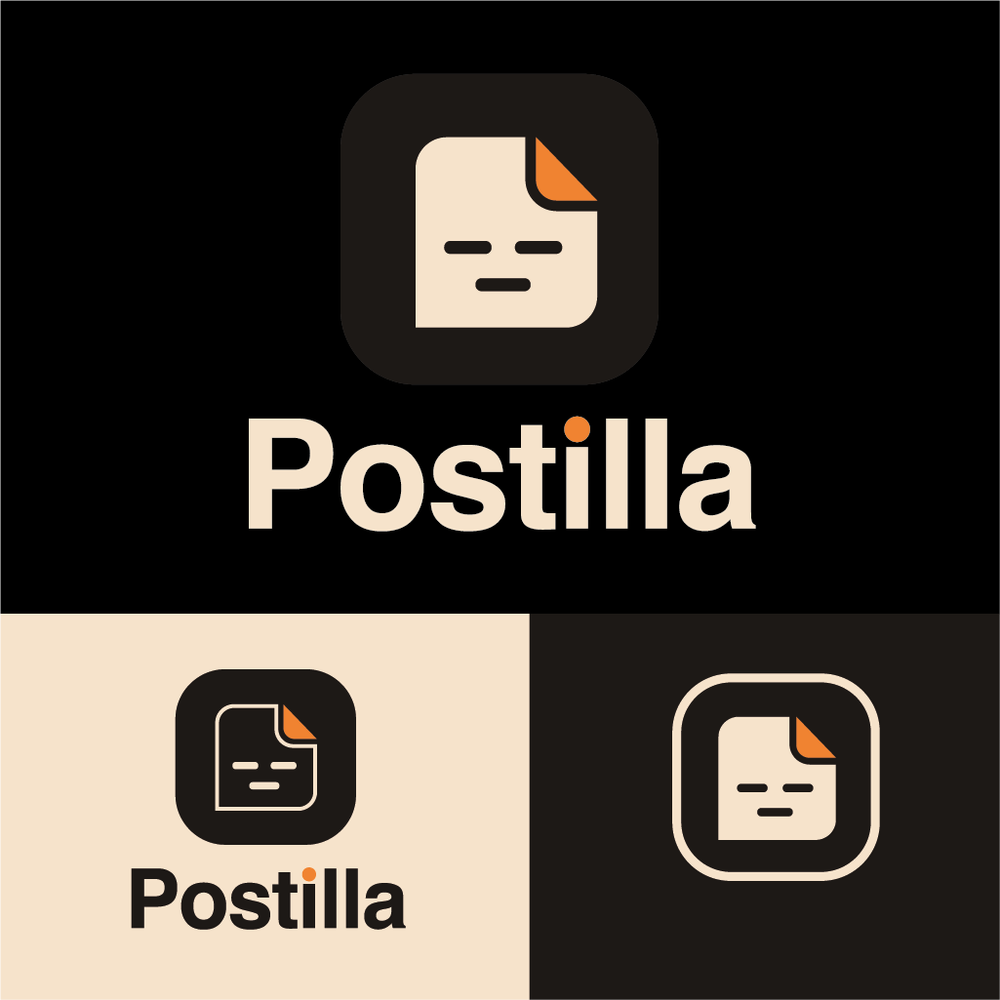

# Postilla

<strong>A place for things worth sharing.</strong>

  An independent, open-source Android client for Nostr — bringing social publishing, private conversations, Lightning and a community marketplace together in one app.

  <a href="https://github.com/isolabellart/postilla-android">Source code</a> ·
  <a href="https://github.com/isolabellart/postilla-android/releases">Download releases</a> ·
  <a href="https://github.com/barrydeen/dark-wisp-android">Original Dark Wisp project</a>

Postilla is an independently maintained downstream project built on the foundations of [Dark Wisp for Android](https://github.com/barrydeen/dark-wisp-android). It is not an official release of the upstream project.

---

## Postilla, in everyday use

Postilla is a mobile home for your Nostr identity. From one Android app you can:

- **Follow and discover:** read feeds and profiles, search for people and topics, follow hashtags and join conversations.
- **Share:** publish text, photos, picture-focused posts, videos and polls; add descriptions to media and save drafts.
- **Take part:** reply, repost, react, bookmark content and receive notifications about activity that matters to you.
- **Read articles:** open long-form Nostr articles and follow the discussions around them.
- **Message privately:** exchange encrypted direct messages, share media and translate conversations when needed.
- **Explore the Marketplace:** browse products and services, publish listings, save favourites, comment and contact sellers.
- **Use Lightning:** manage a wallet, send and receive payments, create a Lightning address and send Zaps.
- **Join communities:** discover and participate in NIP-29 groups and follow live activities.
- **Stay in control:** manage accounts, keys, relays, privacy filters and optional Tor routing.

Postilla is built around an open network: your identity is yours, and your experience is not tied to a single social platform or central server.

## Screenshots

  
  
  
  
  

## The Postilla identity

Postilla's visual language is editorial and understated: warm ivory, deep charcoal, generous whitespace and a restrained orange accent.

  

---

# Technical overview

## Social, publishing and discovery

- Home feeds, profile timelines, hashtag feeds, profile and content search.
- Text notes, replies, quotes and reposts; emoji and custom-emoji reactions.
- Picture-focused posts (NIP-68), video posts (NIP-71), media descriptions and gallery mode.
- Polls (NIP-88) and Zap polls (NIP-69).
- Long-form articles (NIP-23) with formatted content and threaded discussion reading.
- Notifications, bookmarks, pinned notes, mute lists and custom lists/follow sets (NIP-51).
- Draft creation and restoration using NIP-37.
- Profile editing, NIP-05 verification, mentions, QR codes and NIP-19 identifiers.

## Private messaging

- NIP-17 direct messages using gift wraps (rumor, seal and gift wrap), with NIP-44 encryption.
- Legacy NIP-04 cryptography for compatibility.
- Dedicated private-message relay preferences, including NIP-17 kind 10050.
- Encrypted media attachments and private message reactions.
- Remote signing through compatible Android signer apps such as Amber (NIP-55).
- On-demand message translation using the integrated translation services; the original Nostr message is not changed.
- Links from Marketplace conversations to the listing being discussed.

## Marketplace

The built-in Marketplace uses NIP-99 addressable listings (kind 30402).

- Browse all listings, listings from followed accounts or a user's own listings.
- Search and filter by category; open listing details and seller profiles.
- Publish, edit and withdraw your own product or service listings.
- Resolve listings by their stable author-and-identifier address, so revisions are not treated as separate products.
- Show price, images, location and availability information when supplied by the seller.
- Save listings to a personal NIP-51 watchlist and display community interest.
- React to listings, send Zaps and publish NIP-22 comments on addressable listings.

**Scope note:** this is a listing and discovery experience, not a full escrow or order-management platform. NIP-22 support is partial: top-level comments on addressable listings are supported, while replies to comments still use the regular NIP-10 note-thread model.

## Lightning and payments

- Embedded wallet powered by Breez SDK Spark.
- Nostr Wallet Connect (NWC / NIP-47) for compatible external wallets.
- Send and receive Lightning payments, scan or import invoices, and view transaction activity.
- Lightning address management where supported by the wallet service.
- Nostr Zaps (NIP-57) and Zap-enabled interactions.
- On-chain withdrawal support through the Spark wallet integration.
- Additional payment targets and currency display/conversion tools.

Keep recovery phrases, private keys and wallet connection strings secret. Postilla will never need you to share them with another person.

## Groups, live activity and media

- NIP-29 relay-based groups: discovery, joining, group chat and selected group-management actions.
- NIP-53 live activities and streams.
- Blossom upload and retrieval for media, with per-account server preferences and signed upload authorization.
- Optional encrypted media uploads for supported private-message attachments.
- Image, animated image, audio and video display/playback, including Android media controls and picture-in-picture where supported.

NIP-29 group administration is not yet a complete implementation of every protocol command.

## Relays, privacy and account control

- Multiple Nostr accounts and local key management.
- Optional remote signing through NIP-55-compatible signer apps.
- NIP-65 outbox/inbox relay lists, relay-aware event discovery and author-based read routing.
- Relay information (NIP-11), relay authentication (NIP-42), health tracking, reconnect handling and diagnostics.
- Optional embedded Tor routing for app network traffic.
- Mute lists, blocked users and relay filters, keyword filtering and social-graph controls.
- NIP-05 identity verification and NIP-19 npub, nsec, note, nevent, nprofile and naddr identifiers.
- Local event and conversation caching to improve continuity and responsiveness.

Nostr is a decentralized network: event availability, history and delivery depend on the relays chosen by users and by the people they follow. A client cannot retrieve an event that is no longer available from any relay and was never saved locally.

## Protocol support

Postilla includes implementations or integrations for the following protocols. The scope is not identical for every NIP; the notes above describe important limitations.

| Protocol | Use in Postilla |
|---|---|
| NIP-01, 02 | Core events and follow lists |
| NIP-04, 17, 44 | Legacy and modern encrypted messaging |
| NIP-05, 19 | Identity verification and human-readable identifiers |
| NIP-09, 10, 18, 25, 30 | Deletion, threads, reposts, reactions and custom emoji |
| NIP-11, 42, 65 | Relay information, authentication and relay lists |
| NIP-13 | Proof of Work |
| NIP-22 | Comments; partial support as described above |
| NIP-23 | Long-form article reading |
| NIP-29, 53 | Groups and live activities |
| NIP-37, 51 | Drafts, bookmarks, lists and mute data |
| NIP-47, 55, 57 | Nostr Wallet Connect, remote signing and Zaps |
| NIP-68, 71 | Picture-focused and video posts |
| NIP-69, 88 | Zap polls and polls |
| NIP-78 | Application-specific data |
| NIP-99 | Classified listings and Marketplace |

Additional integrations include Blossom media servers, Lightning invoices (BOLT-11), Breez SDK Spark, DeepL and Android remote-signer applications.

---

## Architecture and technology

Postilla is a native Android application written in Kotlin. Its interface is built with Jetpack Compose and Material 3; the app follows an MVVM-oriented architecture with repositories, coroutines and reactive state.

| Area | Main technologies |
|---|---|
| Language and build | Kotlin, Gradle, Android Gradle Plugin |
| Interface | Jetpack Compose, Material 3 |
| State and concurrency | Android ViewModel, Kotlin Coroutines and Flow |
| Relay connections | OkHttp WebSockets |
| Serialization | kotlinx.serialization |
| Cryptography | secp256k1, Bouncy Castle and Android protected storage |
| Local persistence | ObjectBox and encrypted preferences |
| Media | Coil, AndroidX Media3 and CameraX |
| Wallet | Breez SDK Spark and NWC |
| Translation | ML Kit and DeepL |
| Privacy routing | Embedded Tor runtime |

### Android compatibility

- Minimum Android version: **Android 8.0 (API 26)**.
- Target SDK: **35**.
- Packaged native ABI: **arm64-v8a**.
- Production application ID: **com.isolabellart.darkwispenhanced**.
- Staging application ID: **com.isolabellart.darkwispenhanced.staging**.

The production application ID and permanent signing identity are retained from the Dark Wisp Enhanced installation line. This allows a correctly signed Postilla build to update that app line; it does not migrate data from the separate upstream Dark Wisp application.

## Build from source

Requirements: JDK 17 and Android SDK 35.

~~~bash
git clone https://github.com/isolabellart/postilla-android.git
cd postilla-android

# Unit tests for the staging variant
./gradlew testStagingUnitTest

# Local debug APK
./gradlew assembleDebug

# Staging APK
./gradlew assembleStaging

# Release APK (requires the permanent signing configuration)
./gradlew assembleRelease
~~~

Release signing material is kept outside the repository. See [RELEASE_SIGNING.md](RELEASE_SIGNING.md), [the development guide](docs/DEVELOPMENT.md), [branching model](docs/BRANCHING.md), [CI/CD map](docs/CI_CD.md) and [release process](docs/RELEASE_PROCESS.md). GitHub Release and Zapstore publication use separate protected workflows.

## Contributing

Bug reports, testing and focused contributions are welcome. Use a feature branch, keep changes scoped, add or update tests where practical, and include the validation performed in your pull request. User-facing changes should also be checked on a real Android device.

## Project lineage and license

Postilla is an independent downstream fork of [Dark Wisp for Android](https://github.com/barrydeen/dark-wisp-android). It is not affiliated with or endorsed by the upstream project.

The project is distributed under the [MIT License](LICENSE). See the license file for the complete terms.

<strong>Built with care for the Nostr ecosystem.</strong>

---

# Postilla — versione italiana

<strong>Un luogo per le cose che meritano di essere condivise.</strong>

  Un client Android indipendente e open source per Nostr: pubblicazione social, conversazioni private, Lightning e un Marketplace di comunità, tutto in un'unica app.

  <a href="https://github.com/isolabellart/postilla-android">Codice sorgente</a> ·
  <a href="https://github.com/isolabellart/postilla-android/releases">Scarica le versioni</a> ·
  <a href="https://github.com/barrydeen/dark-wisp-android">Progetto originale Dark Wisp</a>

Postilla è un progetto derivato, sviluppato e mantenuto in modo indipendente sulle fondamenta di [Dark Wisp per Android](https://github.com/barrydeen/dark-wisp-android). Non è una versione ufficiale del progetto originale.

---

## Postilla nell'uso quotidiano

Postilla è uno spazio mobile per la tua identità Nostr. Da un'unica app Android puoi:

- **Seguire e scoprire:** leggere feed e profili, cercare persone e argomenti, seguire hashtag e partecipare alle conversazioni.
- **Condividere:** pubblicare testi, fotografie, post incentrati sulle immagini, video e sondaggi; aggiungere descrizioni ai contenuti multimediali e salvare bozze.
- **Partecipare:** rispondere, ripubblicare, reagire, salvare contenuti nei segnalibri e ricevere notifiche sulle attività che ti interessano.
- **Leggere articoli:** aprire articoli Nostr di formato esteso e seguire le discussioni che li accompagnano.
- **Comunicare in privato:** scambiare messaggi diretti cifrati, condividere contenuti multimediali e tradurre le conversazioni quando serve.
- **Esplorare il Marketplace:** consultare prodotti e servizi, pubblicare annunci, salvare i preferiti, commentare e contattare i venditori.
- **Usare Lightning:** gestire un wallet, inviare e ricevere pagamenti, creare un indirizzo Lightning e inviare Zap.
- **Entrare nelle comunità:** scoprire e frequentare gruppi NIP-29 e seguire attività in diretta.
- **Mantenere il controllo:** gestire account, chiavi, relay, filtri per la privacy e instradamento opzionale tramite Tor.

Postilla nasce attorno a una rete aperta: la tua identità ti appartiene e la tua esperienza non dipende da un'unica piattaforma social o da un server centrale.

## Schermate

  
  
  
  
  

## L'identità di Postilla

Il linguaggio visivo di Postilla è editoriale e misurato: avorio caldo, antracite profondo, ampi spazi vuoti e un accento arancione discreto.

  

---

# Panoramica tecnica

## Social, pubblicazione e scoperta

- Feed principale, timeline dei profili, feed degli hashtag e ricerca di profili e contenuti.
- Note testuali, risposte, citazioni e ripubblicazioni; reazioni con emoji ed emoji personalizzate.
- Post incentrati sulle immagini (NIP-68), post video (NIP-71), descrizioni dei contenuti multimediali e modalità galleria.
- Sondaggi (NIP-88) e sondaggi con Zap (NIP-69).
- Articoli di formato esteso (NIP-23), con contenuti formattati e lettura delle discussioni a thread.
- Notifiche, segnalibri, note fissate, liste di silenziamento e liste personalizzate/insiemi di account seguiti (NIP-51).
- Creazione e ripristino delle bozze tramite NIP-37.
- Modifica del profilo, verifica NIP-05, menzioni, codici QR e identificativi NIP-19.

## Messaggistica privata

- Messaggi diretti NIP-17 tramite gift wrap (rumor, seal e gift wrap), con cifratura NIP-44.
- Crittografia NIP-04 legacy per compatibilità.
- Preferenze dedicate ai relay per i messaggi privati, incluso il kind 10050 NIP-17.
- Allegati multimediali cifrati e reazioni ai messaggi privati.
- Firma remota tramite app Android compatibili, come Amber (NIP-55).
- Traduzione dei messaggi su richiesta tramite i servizi integrati; il messaggio Nostr originale non viene modificato.
- Collegamenti dalle conversazioni del Marketplace all'annuncio di cui si sta parlando.

## Marketplace

Il Marketplace integrato utilizza annunci addressable NIP-99 (kind 30402).

- Consultazione di tutti gli annunci, di quelli pubblicati dagli account seguiti o dei propri annunci.
- Ricerca e filtri per categoria; apertura dei dettagli dell'annuncio e dei profili dei venditori.
- Pubblicazione, modifica e ritiro dei propri annunci di prodotti o servizi.
- Risoluzione degli annunci tramite il loro indirizzo stabile, composto da autore e identificatore, in modo che le revisioni non vengano trattate come prodotti separati.
- Visualizzazione di prezzo, immagini, posizione e disponibilità, quando queste informazioni sono fornite dal venditore.
- Salvataggio degli annunci in una watchlist personale NIP-51 e visualizzazione dell'interesse della comunità.
- Reazioni agli annunci, invio di Zap e pubblicazione di commenti NIP-22 sugli annunci addressable.

**Limiti funzionali:** si tratta di uno spazio per pubblicare e scoprire annunci, non di una piattaforma completa per escrow o gestione degli ordini. Il supporto NIP-22 è parziale: sono supportati i commenti di primo livello sugli annunci addressable, mentre le risposte ai commenti continuano a utilizzare il normale modello di thread delle note NIP-10.

## Lightning e pagamenti

- Wallet integrato basato su Breez SDK Spark.
- Nostr Wallet Connect (NWC / NIP-47) per wallet esterni compatibili.
- Invio e ricezione di pagamenti Lightning, scansione o importazione di invoice e consultazione delle transazioni.
- Gestione degli indirizzi Lightning, quando supportata dal servizio wallet.
- Zap Nostr (NIP-57) e interazioni abilitate agli Zap.
- Supporto al prelievo on-chain tramite l'integrazione del wallet Spark.
- Ulteriori destinazioni di pagamento e strumenti per visualizzare o convertire le valute.

Mantieni segrete le frasi di recupero, le chiavi private e le stringhe di connessione del wallet. Postilla non avrà mai bisogno che tu le condivida con un'altra persona.

## Gruppi, attività in diretta e contenuti multimediali

- Gruppi basati su relay NIP-29: scoperta, partecipazione, chat di gruppo e alcune operazioni di gestione.
- Attività e dirette NIP-53.
- Caricamento e recupero dei contenuti multimediali tramite Blossom, con preferenze server per account e autorizzazione di caricamento firmata.
- Caricamento opzionale di contenuti multimediali cifrati per gli allegati supportati nei messaggi privati.
- Visualizzazione e riproduzione di immagini, immagini animate, audio e video, inclusi i controlli multimediali Android e il picture-in-picture, dove supportati.

La gestione amministrativa dei gruppi NIP-29 non implementa ancora tutti i comandi previsti dal protocollo.

## Relay, privacy e controllo degli account

- Gestione di più account Nostr e delle chiavi locali.
- Firma remota opzionale tramite app signer compatibili con NIP-55.
- Liste relay outbox/inbox NIP-65, ricerca degli eventi consapevole dei relay e instradamento della lettura in base all'autore.
- Informazioni sui relay (NIP-11), autenticazione dei relay (NIP-42), monitoraggio dello stato, riconnessione e diagnostica.
- Instradamento opzionale del traffico di rete dell'app tramite Tor integrato.
- Liste di silenziamento, utenti bloccati e filtri dei relay, filtri per parole chiave e controlli del grafo sociale.
- Verifica dell'identità NIP-05 e identificativi NIP-19: npub, nsec, note, nevent, nprofile e naddr.
- Cache locale di eventi e conversazioni per migliorare continuità e reattività.

Nostr è una rete decentralizzata: disponibilità, cronologia e consegna degli eventi dipendono dai relay scelti dagli utenti e dalle persone che seguono. Un client non può recuperare un evento che non è più disponibile su alcun relay e che non è mai stato salvato localmente.

## Supporto ai protocolli

Postilla include implementazioni o integrazioni dei seguenti protocolli. Il livello di supporto non è identico per ogni NIP; le note riportate sopra descrivono alcune limitazioni importanti.

| Protocollo | Utilizzo in Postilla |
|---|---|
| NIP-01, 02 | Eventi fondamentali e liste di account seguiti |
| NIP-04, 17, 44 | Messaggistica cifrata legacy e moderna |
| NIP-05, 19 | Verifica dell'identità e identificativi leggibili |
| NIP-09, 10, 18, 25, 30 | Cancellazioni, thread, ripubblicazioni, reazioni ed emoji personalizzate |
| NIP-11, 42, 65 | Informazioni, autenticazione e liste dei relay |
| NIP-13 | Proof of Work |
| NIP-22 | Commenti; supporto parziale come descritto sopra |
| NIP-23 | Lettura di articoli di formato esteso |
| NIP-29, 53 | Gruppi e attività in diretta |
| NIP-37, 51 | Bozze, segnalibri, liste e dati di silenziamento |
| NIP-47, 55, 57 | Nostr Wallet Connect, firma remota e Zap |
| NIP-68, 71 | Post incentrati sulle immagini e post video |
| NIP-69, 88 | Sondaggi con Zap e sondaggi |
| NIP-78 | Dati specifici dell'applicazione |
| NIP-99 | Annunci classificati e Marketplace |

Le integrazioni aggiuntive comprendono server multimediali Blossom, invoice Lightning (BOLT-11), Breez SDK Spark, DeepL e applicazioni Android per la firma remota.

---

## Architettura e tecnologie

Postilla è un'applicazione Android nativa scritta in Kotlin. L'interfaccia è realizzata con Jetpack Compose e Material 3; l'app segue un'architettura orientata a MVVM, con repository, coroutine e stato reattivo.

| Area | Tecnologie principali |
|---|---|
| Linguaggio e build | Kotlin, Gradle, Android Gradle Plugin |
| Interfaccia | Jetpack Compose, Material 3 |
| Stato e concorrenza | Android ViewModel, Kotlin Coroutines e Flow |
| Connessioni ai relay | WebSocket OkHttp |
| Serializzazione | kotlinx.serialization |
| Crittografia | secp256k1, Bouncy Castle e archiviazione protetta Android |
| Persistenza locale | ObjectBox e preferenze cifrate |
| Contenuti multimediali | Coil, AndroidX Media3 e CameraX |
| Wallet | Breez SDK Spark e NWC |
| Traduzione | ML Kit e DeepL |
| Instradamento per la privacy | Runtime Tor integrato |

### Compatibilità Android

- Versione minima di Android: **Android 8.0 (API 26)**.
- SDK target: **35**.
- ABI nativa inclusa nel pacchetto: **arm64-v8a**.
- Application ID di produzione: **com.isolabellart.darkwispenhanced**.
- Application ID di staging: **com.isolabellart.darkwispenhanced.staging**.

L'application ID di produzione e l'identità permanente di firma sono mantenuti dalla linea di installazione Dark Wisp Enhanced. Questo consente a una build Postilla firmata correttamente di aggiornare quella linea di app; non comporta la migrazione dei dati dall'applicazione Dark Wisp originale, che è separata.

## Compilare dai sorgenti

Requisiti: JDK 17 e Android SDK 35.

~~~bash
git clone https://github.com/isolabellart/postilla-android.git
cd postilla-android

# Test unitari per la variante staging
./gradlew testStagingUnitTest

# APK debug locale
./gradlew assembleDebug

# APK staging
./gradlew assembleStaging

# APK release (richiede la configurazione permanente di firma)
./gradlew assembleRelease
~~~

I materiali per la firma delle release sono conservati al di fuori del repository. Consulta [RELEASE_SIGNING.md](RELEASE_SIGNING.md), [la guida allo sviluppo](docs/DEVELOPMENT.md), [il modello dei branch](docs/BRANCHING.md), [la mappa CI/CD](docs/CI_CD.md) e [il processo di release](docs/RELEASE_PROCESS.md). La pubblicazione su GitHub Releases e Zapstore utilizza workflow protetti separati.

## Contribuire

Sono benvenuti bug report, test e contributi mirati. Utilizza un branch dedicato alle funzionalità, mantieni le modifiche circoscritte, aggiungi o aggiorna i test quando possibile e indica nella pull request le verifiche eseguite. Le modifiche visibili agli utenti dovrebbero essere provate anche su un dispositivo Android reale.

## Origini del progetto e licenza

Postilla è un fork indipendente derivato da [Dark Wisp per Android](https://github.com/barrydeen/dark-wisp-android). Non è affiliato né approvato dal progetto originale.

Il progetto è distribuito con [licenza MIT](LICENSE). Consulta il file della licenza per conoscere tutte le condizioni.

<strong>Realizzato con cura per l'ecosistema Nostr.</strong>

